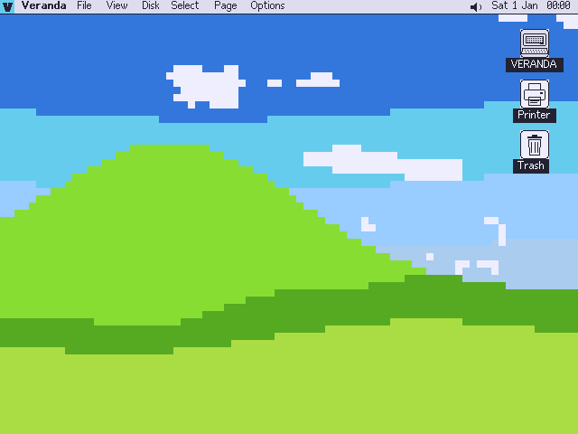
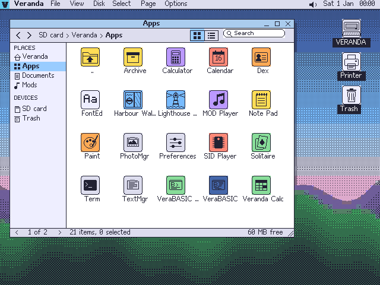
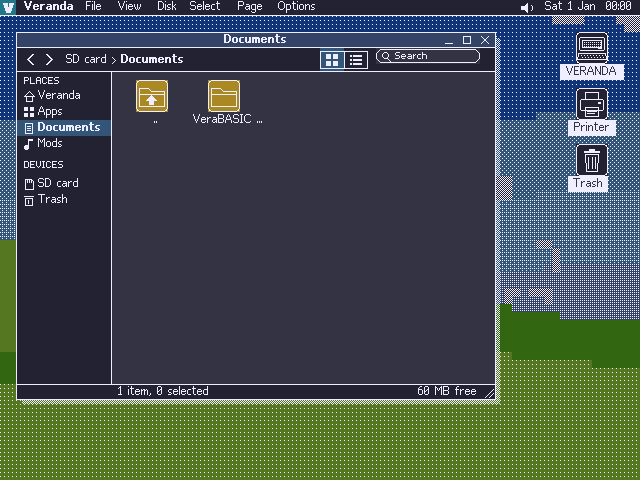
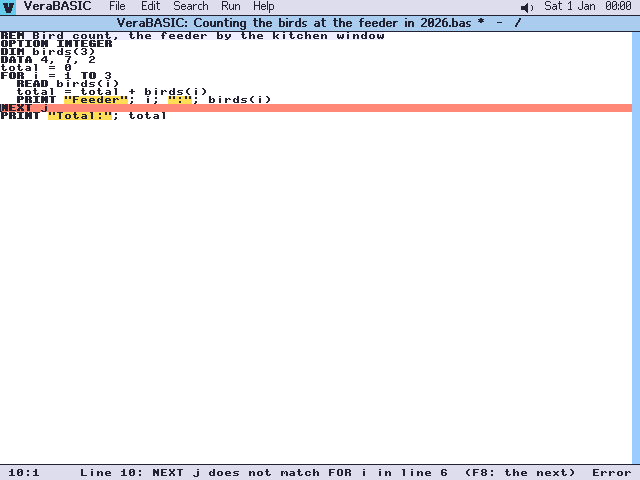
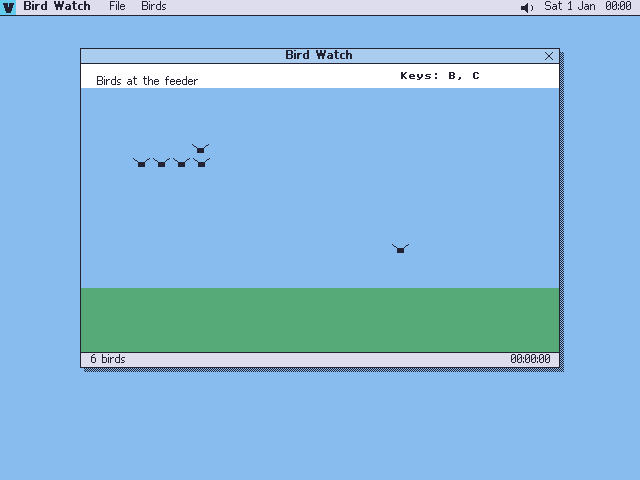
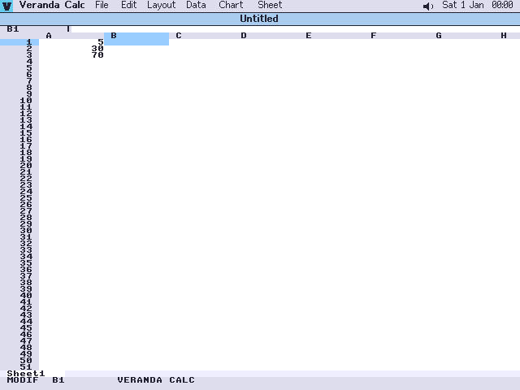
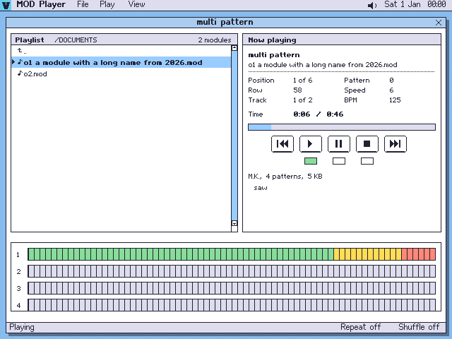
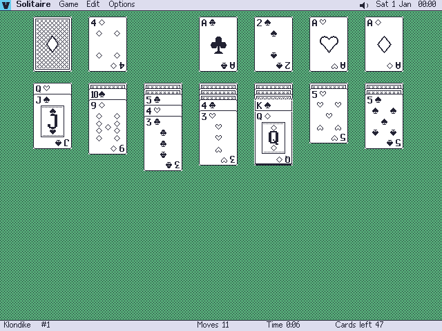
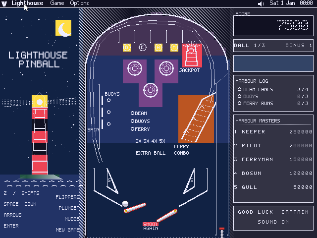
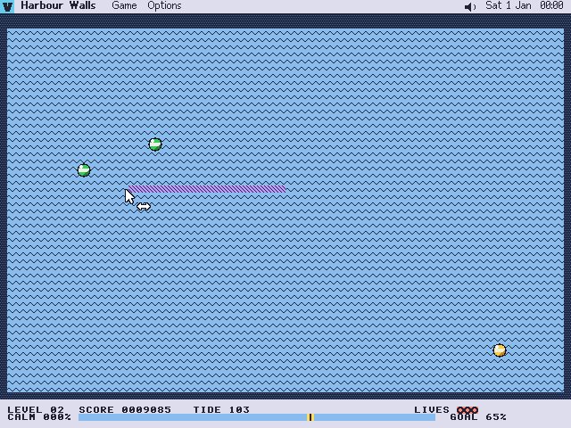

# Veranda for the Commander X16

Veranda is a graphical desktop operating system for the
[Commander X16](https://www.commanderx16.com/), written from scratch for the
machine. Its programming interface is GEOS's: menus, icons, dialog boxes,
GraphicsString, record files and the r0-r15 registers work as GEOS
programmers know them. On top of that it adds what the X16 makes possible:
a 640x480 screen on VERA, 16-bit coordinates, a kernel in banked RAM, FAT32
files with long names on the SD card, and an SDK for writing applications
in C (cc65) or assembly.

This repository holds Veranda itself and the applications and games that
are free to redistribute, in one tree that builds an SD card package.

## Features

- **Veranda Look 2 everywhere.** The desktop, the desk accessories and
  every application in this tree (Paint, Edit, View, Archive, Term, FontEd,
  Veranda Calc, MOD Player, SID Player, VeraBASIC and the games) share one
  look: Look 2's palette and colour themes, the kernel's menu bar, window
  chrome and status bars in the UI font, the standard Open and Save
  dialog, a tile for each program, light and dark mode.
- **The Look 2 desktop.** Folder windows with application tiles, a list
  view (name, size, date, kind) and a search field; a sidebar with places
  (Veranda, Apps, Documents, Mods) and devices (the SD card, the trash);
  breadcrumbs, back and forward. Drag to copy or move, find, get info,
  folders copied whole, the trash.
- **The dock and the switcher.** Alt+Tab puts the running program aside
  in RAM banks, whole, and brings up the desktop; the dock shows pinned
  programs and the ones put aside, and a click brings one back exactly
  where it was. Windows minimise to the dock.
- **Desktop pictures:** Dusk (the default) and Meadow, a green hill under
  a blue sky (`tools/mkwall.py` turns your own picture into one); plain
  colours or patterns; **dark mode**. Colour themes for the menu bars,
  title bars and highlights.
- **Long file names** on the FAT32 card, shown and kept everywhere.
- **The standard Open and Save dialog** (folders, long names, the card),
  used by all native programs; window chrome and menus in Veranda's UI
  font from the SDK.
- **System sounds** (a start-up chime, application start, dialog boxes,
  the trash, optional menu ticks) with a volume setting.
- **BASIC and back.** *BASIC (keep Veranda)* leaves Veranda in memory;
  `SYS 35328` or `RBOOT` brings the desktop back from RAM, and *Quit
  Veranda* frees everything.
- **Printing to PDF** (150 or 300 dpi, A4 or Letter), and pictures to BMP.
- **Fonts** in RAM banks, shared by every program: Gate Sans and Gate
  Mono included, GEOS font files loadable, and a font editor.
- **Desk accessories** that open over any program: Calculator, Note Pad,
  Dex (an address book), Calendar (with alarms), Preferences, Photo
  Manager and Text Manager (the clipboard's albums).
- **VeraBASIC**, a BASIC for Veranda, with its editor. *VeraBASIC* is the
  editor and the runtime in one program: syntax colouring, the syntax of
  the keyword at the cursor in the status bar, Check (Ctrl+K) and Run
  (Ctrl+R), an error or a stop jumps to its line, F1 opens the keyword's
  help page. Programs get Veranda's windows, menus, events and timers,
  graphics, text and fonts, colour, the mouse and the keys, sound, files
  and folders, message and dialog boxes, Open and Save, the clipboard,
  pictures, icons, tiles and sprites. *VeraBASIC Run* runs finished
  programs. The manual (`veranda/docs/vbasic/manual`) has a tutorial,
  seven steps to *Bird Watch*; the package puts the help in
  `/VERANDA/HELP` and the example programs and the tutorial's steps in
  `/DOCUMENTS/VeraBASIC Examples`.
- **Applications:** Paint, Veranda Edit (text files up to about 330 KB),
  View (text, BMP pictures, Paint documents), Archive (C64/C128 GEOS disk
  images: list and extract), Term (ANSI, Telnet and XMODEM over a serial
  or Wi-Fi card), FontEd, Veranda Calc (a spreadsheet that reads and
  writes XLSX, ODS and CSV), MOD Player (ProTracker modules) and SID
  Player (for the X16-SID card).
- **Games:** Solitaire (Klondike, FreeCell, Spider, Golf, Pyramid, Yukon
  and more), Lighthouse Pinball and Harbour Walls.
- **Crash recovery:** a crashed program shows a panic box, and the
  desktop comes back with the kernel restored from its copy in RAM.

## Screenshots

| | |
|---|---|
|  |  |
| The Apps folder of the SD card package | Dark mode, with Meadow's dark variant |
|  |  |
| VeraBASIC: the editor's colours, and a run's error shown at its line | Bird Watch, the tutorial's program, in VeraBASIC |
|  |  |
| Veranda Calc | MOD Player playing a module the tests make |
|  |  |
| Solitaire: Klondike | Lighthouse Pinball |
|  | |
| Harbour Walls | |

All screenshots are taken in the x16emu emulator under ROM R49, from
this repository's build and gates; everything in them is made by the
tests (no one's own files or music).

## Hardware

- A Commander X16 (or x16emu).
- 512 KB of banked RAM at least; 2 MB recommended (more programs can be
  put aside at once, and larger documents fit).
- VERA firmware 0.3.1 or later for the FX cache writes that make fills,
  copies and window moves fast. Older firmware works, more slowly.
- Tested with the X16 ROM release R49.
- An SD card (FAT32). Long names need nothing special.
- SID Player needs the X16-SID card; Term needs a serial or Wi-Fi card.

## Installing on an SD card

Build the package (see below), or take it from a release, then copy both
folders to the top of the card:

    dist/VERANDA    ->  /VERANDA     the system, its applications, fonts
                                     and desktop pictures
    dist/DOCUMENTS  ->  /DOCUMENTS   your files (empty at first)

On the X16:

    DOS"CD:VERANDA"
    BOOT

(or `LOAD"VERANDA.PRG"` and `RUN`). The desktop opens in /DOCUMENTS.
Veranda keeps its settings, the clipboard and the trash in the hidden
folder /VERANDA/.SYSTEM. `dist/VERANDA/README.txt` has the details, and
how to update a card that has an older Veranda.

## Building

You need:

- **cc65 2.19** (`cl65`, `ca65`, `ld65`, `ar65`). Set `CC65_HOME` if it is
  not in `~/.local/share/cc65`.
- **Python 3** with **Pillow** (the build tools use only the standard
  library, except the Meadow wallpaper's, which `make dist` runs; some
  gates use Pillow too).
- **make**, a C compiler (host-side tests), `git`.

Then:

    make            # Veranda, the SDK, every application, and dist/
    make build      # everything without the package
    make dist       # the SD card package only, in dist/
    make clean

`make build` leaves the kernel in `veranda/build/` (`VERANDA.PRG`,
`VERANDA.SYS`, `RBOOT`), the SDK in `veranda/build/sdk` and Veranda's own
programs in `build/apps/` (VeraBASIC's editor in
`build/apps/vbasic/ide/`); each application in `apps/` builds in its own
`build/`. `make dist` runs `veranda/tools/mkdist.sh`, which builds
everything again in a work folder and writes `dist/VERANDA` (the system,
`APPS`, `FONTS`, `HELP`, and `WALLPAPERS` with Dusk and Meadow) and
`dist/DOCUMENTS` (the VeraBASIC examples). `MKDIST_SIBLINGS=1` makes it
take the applications from sibling repositories instead of `apps/`, as
in Veranda's own repository.

To write your own program, start from the SDK's documentation:
[veranda/sdk/docs/README.md](veranda/sdk/docs/README.md) and the
programming guide [veranda/sdk/docs/GUIDE.md](veranda/sdk/docs/GUIDE.md).

### Tests ("gates")

Every part of the system has a gate: a script that builds it, runs it in
the emulator, and checks the screen, the console and memory dumps.

    make gates                          # Veranda's core gates
    cd veranda && tools/gate_shell.sh   # one of the others (tools/gate_*.sh)
    cd veranda && tools/gate_vb_ide.sh  # VeraBASIC's editor (gate_vb_*.sh: the rest)
    cd apps/pinball && tools/gate.sh    # an application's gate

An application's gate builds Veranda from `veranda/` in its own work
folder: Veranda Calc `make x16` (the overlay check reads its labels)
then `tools/gate_veranda.sh`, MOD Player `make vsdk` then
`tools/gate_vmp_mouse.sh`, Solitaire `tools/gate_veranda.sh`, Lighthouse
Pinball and Harbour Walls `tools/gate.sh`, SID Player `make vsdk`,
`tools/mkemu.sh` (its emulator) then `make gate`.

Some gates run on a host folder and expect it to list files in the order
they were made, as disk file systems and the SD card do: gate `vb_ide`'s
step 4 (the shell opens a `.bas` with the editor, the first program in
the folder that opens `.bas`) fails on a tmpfs, which lists them the
other way round. Run the gates from a disk.

The gates run x16emu headless and take the emulator and ROM from
environment variables (`EMU`, `ROM`, and for the R49 runs `R49`; the
applications' gates also use `MEMU`, `X16EMU`, `X16ROM`). They need:

- **x16emu** from [X16Community/x16-emulator](https://github.com/X16Community/x16-emulator),
  with a small patch that makes host key auto-repeat opt-in
  (`-nokbdrepeat`);
- for gates that drive the real mouse path, an x16emu with
  **`-mousescript`** (feeds the emulated PS/2 mouse from a script; `MEMU`);
- for Term's gate, an x16emu with **`-uart`** (a 16C550 connected to a TCP
  port or a file);
- for SID Player's gate, an x16emu with the **X16-SID card model**
  (CommanderSID's emulator patches) and `-mousescript`
  (`apps/sidplay/tools/mkemu.sh` builds it from such a tree);
- the **X16 ROM** (`rom.bin`), R49 or a build of x16-rom.

These emulator patches are not part of this repository. A gate whose
emulator or reference is missing reports SKIP or says what it needs. A few
of Veranda's early gates can compare drawing against GEOS 64's KERNAL when
a reference build is available (`GEOS64_REF`); without it they report SKIP.

## Repository layout

    veranda/            Veranda: the kernel, the loader, the shell, the SDK,
                        the built-in applications and desk accessories,
                        VeraBASIC, the tools and the gates
      kernel/           the kernel, in banked RAM (ca65)
      shell/            the desktop (C)
      sdk/              the SDK: headers, libraries, linker configs, docs
      apps/             Paint, Edit, View, Archive, Term, FontEd, Setup,
                        VeraBASIC (apps/vbasic: the editor and VeraBASIC
                        Run) and the desk accessories
      vbasic/           VeraBASIC's keyword table, generated tables and help
      tests/            the gates' fixtures and checkers (all synthetic)
      api/              the API table everything is generated from
      docs/             PLAN.md, DECISIONS.md, APPFORMAT.md, API.md;
                        vbasic/: VeraBASIC's manual and example programs
      tools/            the build tools, mkdist.sh, the gates;
                        wallpapers/: the Meadow picture's generator
    apps/
      calc/             Veranda Calc (Commander Calc's Veranda build)
      modplayer/        MOD Player and the x16-mod replay library
      solitaire/        Solitaire
      pinball/          Lighthouse Pinball
      harbour-walls/    Harbour Walls
      sidplay/          SID Player
    docs/screenshots/   the pictures in this README
    Makefile            builds all of the above and the SD card package

## Not included

Three ports of classic GEOS programs run on Veranda but are **not** in
this repository: geoWrite, TopDesk and geoChess. They contain or derive
from Berkeley Softworks' and other third parties' code, which may not be
redistributed. They are kept separately, for personal use only, and the
package built here does not contain them. No C64 or GEOS ROMs, disk
images, SID tunes or MOD modules are included either: the tests make
their own synthetic fixtures. The SID Player's gate has an optional part
that plays tunes from a local copy of the HVSC (`HVSC=<folder>`); without
one it reports SKIP, and none of its pictures are in this repository.

## Licences

| Part | Licence | Notes |
|---|---|---|
| `veranda/` | MIT | `veranda/LICENSE` (VeraBASIC, the SDK's textkit and the Meadow wallpaper included) |
| `apps/calc/` | MIT | `apps/calc/LICENSE` |
| `apps/modplayer/` | MIT | `apps/modplayer/LICENSE`; `vendor/micromod-c` is Martin Cameron's micromod (BSD 3-Clause), used only as a test oracle |
| `apps/pinball/` | MIT | `apps/pinball/LICENSE` |
| `apps/harbour-walls/` | MIT | `apps/harbour-walls/LICENSE` |
| `apps/solitaire/` | GPL-3.0-or-later | `apps/solitaire/COPYING`, `NOTICE` (derived from PySolFC) |
| `apps/sidplay/` | GPL-3.0-or-later | `apps/sidplay/COPYING`, `NOTICE` (a port of CommanderSID's player) |

The MIT parts are Copyright (c) 2026 Marcin Spoczynski. Each directory's
licence applies to the files in it; building the package combines them
only as separate programs on one card.

## Credits

- **CommanderSID**: the X16-SID card, its firmware and its SID player,
  which SID Player is a port of (`apps/sidplay/NOTICE`).
- **PySolFC** and **pysol_cards** (Shlomi Fish and PySol's authors): the
  rules and deal numbers that Solitaire translates into C
  (`apps/solitaire/NOTICE`). The card pictures are drawn for Solitaire.
- **ProTracker**: the MOD format and its replay behaviour, which
  x16-mod follows; **micromod** by Martin Cameron, the reference its
  sequencer is tested against.
- **GEOS** by Berkeley Softworks, whose programming interface Veranda
  implements. Veranda contains no GEOS code.
- The **Commander X16** project, its ROM and x16emu.
